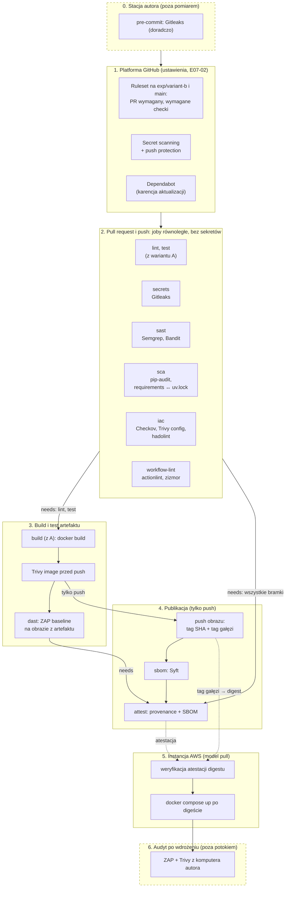

# Projekt potoku DevSecOps (wariant B) i polityka bramek

> **Status:** projekt po wywiadzie z autorem (E07-01, 2026-11-20). Decyzje autora są w sekcji 5 (D1–D13), wynik przeglądu ocen w sekcji 7. Decyzje zbiera [ADR-0042](adr/0042-projekt-potoku-wariantu-b.md), a ten plik jest opisem projektu, do którego ADR się odwołuje.
>
> Numer ADR: katalog zadań podaje `docs/adr/0003-projekt-potoku.md`, ale numer 0003 ma już ADR o AWS, więc projekt dostanie numer 0042 (uwaga z E02-02).

Plik odpowiada na trzy kryteria E07-01:

1. diagram potoku (sekcja 2),
2. tabela krok → zagrożenie → standard (sekcja 3),
3. polityka bramek na piśmie (sekcja 4).

Tabela z sekcji 3 to rdzeń rozdz. 4.3 i punkt wyjścia do oceny pokrycia listy kontrolnej (C2, C5, RQ3 w `docs/metodyka.md`).

## 1. Założenia wejściowe (już przyjęte)

Te ustalenia zapadły wcześniej i projekt ich nie zmienia:

| Ustalenie | Źródło |
|---|---|
| Wariant B przejmuje joby `lint`, `test` i `build` z tagu `pipeline-a-v1` bez zmian. Workflow A da się uzyskać z B przez usunięcie jobów i kroków bezpieczeństwa (K2) | ADR-0041, `experiment/PROTOCOL.md` (K2) |
| Potok nie ma poświadczeń AWS. Instancja sama śledzi tag gałęzi w GHCR i wdraża obraz po digeście (model pull, timer co minutę) | ADR-0032, ADR-0033 |
| Pull request tylko buduje obraz, a push na gałąź buduje go i publikuje z tagiem `<gałąź>-sha-<commit>` i tagiem gałęzi | ADR-0036, ADR-0040 |
| Jednostką próby jest PR od czystej wersji z jedną podatnością. Zatrzymanie = blokada, w której zgłoszeniach blokujących jest trafienie pozycji (Z1). Blokada bez trafienia (Z3) nie liczy się do H1 | `experiment/PROTOCOL.md`, p. 3.3 |
| Narzędzia zapisują pełne raporty (także poniżej progu). Próg stosuje osobny krok bramki. Progi i konfiguracja ZAP są zamrożone przed serią (K5) | `experiment/PROTOCOL.md`, sekcja 0 i K5 |
| Joby-bramki są wymaganymi *status checks* na `exp/variant-b` | `experiment/PROTOCOL.md`, sekcja 0 |
| DAST: ZAP baseline na kontenerze w runnerze na każdym PR, jako bramka | `docs/metodyka.md` (decyzja autora z 2026-10-13, E03-05) |
| SAST: Semgrep z regułami własnymi dla GT-06 i GT-14 (blokują jak reguły z rejestru) i Bandit. CodeQL nie wchodzi do wariantu B, tylko do serii porównawczej | `docs/narzedzia.md`, p. 4.2 i 4.3 (decyzje autora z 2026-10-20) |
| SBOM: Syft zapisuje SPDX JSON i CycloneDX JSON, atestowany jest SPDX | `docs/narzedzia.md`, p. 4.4 |
| Atestacje przez `actions/attest`. SLSA Build L2 jako próg, L3 (osobny job atestacji) jako cel rozszerzony | E02-05, `docs/notes/slsa.md` |
| Mapowanie na SSDF według definicji SSDF: SAST → PW.7, SCA → PW.4.4, DAST → PW.8 | E02-03 (decyzja autora z 2026-10-06) |
| Z Guideline do E07-01: „fail closed” z jawnymi kodami wyjścia, karencja aktualizacji w Dependabocie, hook pre-commit poza pomiarem. ZAP API scan odłożony | E02-04 (decyzje autora z 2026-10-28) |
| Kontrola zgodności `requirements.txt` z `uv.lock` należy do wariantu B | E06-05 (decyzja autora z 2026-11-20) |
| Skany pomijają `semgrep-rules/`, bo pliki testów reguł są celowo podatne | E02-10 |
| Trivy dla obrazu: wersja czysta ma 49 HIGH w pakietach systemowych bez poprawki, a tylko 3 zgłoszenia z poprawką (stan 2026-11-08). Decyzja o `--ignore-unfixed` należy do E07 | E05-01 |

## 2. Diagram potoku

Etapy wariantu B. Ramki z przerywaną linią to elementy spoza pomiaru, a strzałki przerywane to przejścia poza potokiem (instancja odpytuje rejestr i magazyn atestacji). Strzałka z ramki „2.” oznacza wszystkie joby tej ramki.

Uwagi do diagramu:

- **Na PR bramki egzekwuje ruleset**, nie `needs:`. Joby PR biegną równolegle do `lint` i `test`, więc czas PR to najdłuższa ścieżka, a nie suma (ważne dla H2a). Na PR nie ma publikacji, SBOM ani atestacji.
- **Na pushu** (po scaleniu) biegnie ten sam zestaw jobów (D4). `build` publikuje obraz i przesuwa tag gałęzi jak w wariancie A, ale agent nie wdroży digestu, dopóki job `attest` nie wystawi atestacji, a `attest` czeka (`needs:`) na wszystkie bramki tego samego przebiegu (D3).
- **Weryfikacja atestacji odbywa się na instancji.** Potok nie ma dostępu do AWS (ADR-0032), więc jedynym miejscem, które może odrzucić obraz przed uruchomieniem, jest agent wdrożenia. To jedyna kontrola, która działa także wtedy, gdy ktoś z `packages: write` przesunie tag gałęzi poza potokiem (CICD-SEC-9, uwaga z E05-06).

## 3. Tabela krok → zagrożenie → standard

**Legenda:**

- **Zagrożenie:** ryzyko z OWASP Top 10 CI/CD (`CICD-SEC-n`, `docs/notes/owasp-devsecops.md`, sekcja 3) i pozycje katalogu (`GT-nn`, `experiment/ground-truth.yaml`), które krok ma zatrzymać. Pozycje podano według pola `oczekiwany_detektor`.
- **SP 800-204D:** identyfikatory z tabel A i B w `docs/notes/nist-800-204d.md` (z gwiazdką: identyfikatory nadane w tej pracy).
- **SSDF:** zadanie SSDF według definicji SSDF (decyzja z E02-03), nie według dodatku A SP 800-204D. „(interp.)” = uzupełnienie mapowania przyjęte jako interpretacja autora (D10), bez odpowiednika w dodatku A SP 800-204D.
- **Tryb:** `blokuje` (bramka, wymagany check, wchodzi do M6), `fail closed` (błąd joba bez progu ważności, np. brak SBOM), `doradczo` (raport bez blokady), `ustawienie` (konfiguracja platformy, ocenia ją lista kontrolna, nie seria).

| # | Etap | Krok (job) | Narzędzie | Zagrożenie | SP 800-204D | SSDF | Tryb |
|---|---|---|---|---|---|---|---|
| B01 | 0. Stacja autora | hook pre-commit | Gitleaks | CICD-SEC-6; GT-02 (wcześniej niż PR) | COMMIT-REQ-1 | PS.1.1 (interp.) | doradczo, poza pomiarem |
| B02 | 1. Platforma | ruleset na `exp/variant-b` i `main`: PR wymagany, wymagane checki, bez force push, bez obejść | GitHub rulesets | CICD-SEC-1, CICD-SEC-4 | PP-AUTH*, PP-INT*, BUILD-2*, PULL-PUSH-REQ-1 | PS.1.1, PO.4.2 | ustawienie (egzekwuje bramki) |
| B03 | 1. Platforma | secret scanning i push protection | GitHub | CICD-SEC-6 | COMMIT-REQ-1, COMMIT-REQ-2, DEPLOY-REQ-1 | PS.1.1 (interp.) | ustawienie |
| B04 | 1. Platforma | Dependabot: alerty, security updates, aktualizacje `github-actions` i zależności z karencją | Dependabot | CICD-SEC-3, CICD-SEC-8 | PULL-PUSH-REQ-2, TEST-2*, BASE-4* | PW.4.1, PW.4.4, RV.1.1 | doradczo (alerty i PR-y) |
| B05 | 1. Platforma | domyślny `GITHUB_TOKEN` tylko do odczytu, zgoda na workflow od zewnętrznych, brak `pull_request_target` | GitHub | CICD-SEC-4, CICD-SEC-5, CICD-SEC-7 | PULL-PUSH-REQ-3, PRE-3* | PO.5.1 | ustawienie |
| B06 | 2. PR | `lint`, `test` (z wariantu A) | ruff, pytest | — | PULL-PUSH-REQ-1 | PW.5.1, PW.8.2 | blokuje (jak w A) |
| B07 | 2. PR | `secrets` | Gitleaks | CICD-SEC-6; **GT-02** | COMMIT-REQ-1, DEPLOY-REQ-1 | PS.1.1 (interp.), PW.7.2 | blokuje |
| B08 | 2. PR | `sast` | Semgrep (rejestr + reguły własne) | **GT-01, GT-03, GT-04, GT-05, GT-06, GT-12, GT-14** | TEST-1* | PW.7.1, PW.7.2 | blokuje |
| B09 | 2. PR | `sast` | Bandit | **GT-01, GT-02, GT-03, GT-04** | TEST-1* | PW.7.2 | blokuje |
| B10 | 2. PR | `sca` | pip-audit na `requirements.txt` | CICD-SEC-3 (częściowo, zob. niżej); **GT-07** | TEST-2* | PW.4.4 | blokuje |
| B11 | 2. PR | `sca`: zgodność `requirements.txt` z `uv.lock` | `uv export` + porównanie | CICD-SEC-3 (pip-audit sprawdza inny plik niż ten, z którego powstaje obraz) | BASE-4* | PW.4.1 | fail closed |
| B12 | 2. PR | `sca`: przegląd zależności w PR | `dependency-review-action` | CICD-SEC-3; GT-07 | DEPLOY-REQ-2, BASE-2* | PW.4.4 | **poza wariantem B** (D7) |
| B13 | 2. PR | `iac` | Checkov (`infra/terraform`, `app/Dockerfile`) | **GT-09, GT-10, GT-11** | PRE-5* | PW.9.2, PW.2.1 (Cz) | blokuje |
| B14 | 2. PR | `iac` | Trivy config | **GT-09, GT-10, GT-11** | PRE-5* | PW.9.2 | blokuje |
| B15 | 2. PR | `iac` | hadolint | — (nie jest detektorem GT-09) | PRE-5* | PW.6.2 | blokuje: poziom `error` (D7) |
| B16 | 2. PR | `workflow-lint` | actionlint | CICD-SEC-4; **GT-17** | PRE-5*, DEPLOY-REQ-5 | PO.3.2 | blokuje |
| B17 | 2. PR | `workflow-lint` | zizmor | CICD-SEC-4, CICD-SEC-5, CICD-SEC-8; **GT-15, GT-16, GT-17** | PULL-PUSH-REQ-2, PRE-5*, DEPLOY-REQ-5 | PO.3.2, PW.7.2 | blokuje |
| B18 | 3. Build | `build` (z wariantu A) | docker CLI | — | BUILD-1* | PW.6.1 | blokuje (jak w A) |
| B19 | 3. Build | krok w `build` przed push, potem zapis obrazu jako artefakt (D1, D2) | Trivy image (podatności, sekrety w warstwach) | CICD-SEC-6 (sekrety w warstwach); **GT-08** | DEPLOY-REQ-4, DEPLOY-REQ-5, TEST-2* | PW.4.4 | blokuje |
| B20 | 3. Test | `dast` na obrazie z artefaktu `build` (D2) | OWASP ZAP baseline | **GT-01, GT-05, GT-12, GT-13** (GT-14 tylko przez ręczną ocenę tracebacku) | TEST-1* | PW.8.1, PW.8.2 | blokuje |
| B21 | 4. Publikacja | push obrazu z tagiem SHA (z wariantu A) | docker CLI | — | GitOps-REQ-2 | PS.3.1 | jak w A |
| B22 | 4. Publikacja | `sbom` | Syft (SPDX + CycloneDX) | CICD-SEC-3 (inwentarz komponentów) | TEST-2*, ATT-1*, BASE-4* | PS.3.2 | fail closed |
| B23 | 4. Publikacja | `attest`: provenance i SBOM, `needs:` na wszystkie bramki (D3) | `actions/attest` (Sigstore keyless) | CICD-SEC-9 | BUILD-3*, ATT-1*, ATT-2*, ATT-3* | PS.2.1 (interp.), PS.3.1 (interp.), PS.3.2 | fail closed |
| B24 | 5. Wdrożenie | weryfikacja atestacji na instancji przed `compose up`; brak atestacji = czekaj (D3) | agent wdrożenia + `gh attestation verify` albo `cosign` (E07-09) | CICD-SEC-9, CICD-SEC-1 | DEPLOY-REQ-3, ATT-4* | PS.2.1 | blokuje wdrożenie (fail closed) |
| B25 | 6. Po wdrożeniu | audyt R2 | ZAP baseline, Trivy | — (mierzy M2, etap „audyt po wdrożeniu”) | DEPLOY-REQ-4 (aktualność skanu) | RV.1.2 | poza potokiem, nie bramka |

Elementy z listy kontrolnej, które celowo **nie** są krokami wariantu B (D11):

| Element | Standard | Gdzie zamiast tego |
|---|---|---|
| CodeQL | TEST-1* | seria porównawcza poza wariantem B (decyzja autora z 2026-10-20) |
| `step-security/harden-runner` | PRE-1*, BASE-8* | poza wariantem B (D11); jeśli E07-02 (utwardzenie workflowów) go doda, to jako zmiana tej decyzji z wpisem w dzienniku |
| OpenSSF Scorecard | PULL-PUSH-REQ-4, BASE-6* | miara w ocenie zgodności (C5), nie krok potoku |
| Wykrywanie dryfu (`terraform plan` cyklicznie) | GitOps-REQ-4 | środowisko efemeryczne (ADR-0019) żyje tylko w oknie wdrożenia i audytu |
| Cykliczny ponowny skan obrazu i SBOM | RV.1.2, BASE-5* | poza pomiarem; ewentualnie workflow `schedule` po eksperymencie |
| Podpisane commity | COMMIT-REQ-2, PP-INT* | poza wariantem B (D11); E07-02 może do tego wrócić jak przy harden-runner |

### 3.1. Pokrycie ryzyk CICD-SEC

| Ryzyko | Kroki | Pozycje katalogu | Uwagi |
|---|---|---|---|
| CICD-SEC-1 Flow control | B02, B24 | — | brak drugiego recenzenta (jeden autor) |
| CICD-SEC-2 IAM | B05; brak poświadczeń AWS w potoku (ADR-0032) | — | `packages: write` tylko w jobie `build`; konto autora to pojedynczy punkt awarii |
| CICD-SEC-3 Dependency chain | B04, B10, B11, B22 (B12 poza wariantem, D7) | — (GT-07 ma `owasp_cicd: null`) | złośliwy pakiet bez CVE przejdzie przez pip-audit i Trivy |
| CICD-SEC-4 PPE | B02, B05, B16, B17 | GT-17 | PR może zmienić konfigurację bramki (I-PPE); bez drugiego recenzenta to ryzyko resztkowe (sekcja 4.6) |
| CICD-SEC-5 PBAC | B05, B17 | GT-15 | |
| CICD-SEC-6 Credential hygiene | B01, B03, B07, B19 | GT-02 | |
| CICD-SEC-7 System config | B02, B03, B05 | — | konfiguracja platformy w `infra/github/` i spis w [`ustawienia-github.md`](ustawienia-github.md) (ADR-0043); zmiany ręczne w interfejsie wykrywa tylko porównanie z `settings.sh show` |
| CICD-SEC-8 3rd party | B04, B17; przypinanie do SHA (`AGENTS.md`, zasada 5) | GT-16 | zależności przechodnie akcji złożonych |
| CICD-SEC-9 Artifact integrity | B21–B24 | — | provenance nie wykryje złośliwego kodu w zaufanym buildzie |
| CICD-SEC-10 Logging | raporty i logi jako artefakty, CloudTrail (E08-01) | — | bez SIEM (lekki potok) |

## 4. Polityka bramek

### 4.1. Zasady ogólne

1. **Bramka = job.** Każdy job-bramka jest wymaganym *status check* w rulesecie `exp/variant-b`, sprawdzanym po nazwie joba. Brak wyniku joba (np. job usunięty w PR) blokuje scalenie tak samo jak wynik negatywny.
2. **Dwa kroki w każdej bramce** (`experiment/PROTOCOL.md`, sekcja 0): narzędzie zapisuje pełny raport w formacie maszynowym (JSON albo SARIF), łącznie ze zgłoszeniami poniżej progu, a osobny krok czyta raport, stosuje próg i ustawia kod wyjścia. Raporty idą do artefaktów przebiegu (M1, M6), a SARIF dodatkowo do zakładki Security (PO.3.3).
3. **Fail closed** (Guideline, `2-3-5 Security Gates`):
   - brak pliku raportu, pusty albo niepoprawny raport → bramka nie przechodzi,
   - błąd narzędzia (kod wyjścia inny niż „są zgłoszenia”) → bramka nie przechodzi,
   - przekroczenie `timeout-minutes` → bramka nie przechodzi,
   - kod wyjścia każdego narzędzia sprawdzony w dokumentacji przed zamrożeniem (TODO: zweryfikować dla każdego narzędzia z tabeli 4.2; sprawdzone: Gitleaks 2026-11-24, ADR-0044, zizmor i actionlint w ADR-0043, Semgrep i Bandit 2026-11-24, ADR-0045, pip-audit 2026-11-24, ADR-0046: kod 1 także przy błędzie, więc bramka sprawdza raport, a nie kod wyjścia).
4. **Progi są stałe przez całą serię** (K5). Zmiana progu po starcie serii oznacza powtórzenie serii (`experiment/PROTOCOL.md`, sekcja 0).
5. **Wersje narzędzi przypięte** (K4): akcje do SHA, obrazy do digestu, pakiety PyPI do dokładnej wersji. Wersje trafią do `experiment/versions/variant-b.yaml` w układzie pliku wariantu A.

### 4.2. Progi blokady (decyzje D5, D5a, D7, D8)

**Reguła ogólna** (decyzje autora z 2026-11-20, sekcja 5):

- **własny kod i konfiguracja** (kod aplikacji, Terraform, Dockerfile, workflow): blokuje każde zgłoszenie poza najniższym, informacyjnym poziomem narzędzia,
- **komponenty zewnętrzne i działająca aplikacja** (CVE w pakietach obrazu, alerty DAST): blokuje od poziomu Medium wzwyż,
- narzędzia bez skali ważności (Gitleaks, pip-audit, actionlint, Checkov bez platformy) blokują każde zgłoszenie.

Skutki reguły dla pozycji katalogu sprawdzamy po jej przyjęciu i zapisujemy w dzienniku badawczym. Reguły nie dopasowujemy do wyniku (TW1).

| Bramka | Narzędzie | Co blokuje | Co tylko raportuje | Uwagi |
|---|---|---|---|---|
| `secrets` | Gitleaks | każde zgłoszenie | — | Gitleaks nie ma poziomów ważności. Skan commitów PR (`base..head`) albo pushu (`before..after`); `--exit-code 2` oddziela zgłoszenia od błędu narzędzia (kod 1); ADR-0044 |
| `sast` | Semgrep | wszystko poza `INFO`: `ERROR`, `WARNING`, a z nowej skali także `LOW`, `MEDIUM`, `HIGH`, `CRITICAL` i każda nieznana wartość | `INFO` | Skala w regułach rejestru jest mieszana (Semgrep 1.185.0, 2026-11-24: `p/default` ma reguły `ERROR`, `WARNING`, `INFO` i 11 reguł `MEDIUM`), a `--severity` zna tylko starą skalę, więc próg stosuje `.github/scripts/sast_gate.py` na raporcie JSON (ADR-0045, T7) |
| `sast` | Bandit | ważność `LOW` i wyżej przy pewności `MEDIUM` i wyżej (nieznana pewność też blokuje) | pewność `LOW` | B105 ma w Bandit 1.9.4 ważność LOW i pewność MEDIUM (`general_hardcoded_password.py`), więc blokuje. GT-02 ma trzy detektory blokujące: Gitleaks, Bandit B105 i Semgrep `detected-generic-secret` z `p/default` (łatka próbna, 2026-11-24, ADR-0045) |
| `sca` | pip-audit | każda znana podatność spoza listy wyjątków | — | pip-audit 2.10.1 nie ma filtra ważności, a jego raport JSON nie podaje ważności (sprawdzone 2026-11-24). Baza OSV, tylko zależności runtime, Python 3.14 jak w aplikacji; próg stosuje `.github/scripts/sca_gate.py` na raporcie JSON (ADR-0046) |
| `sca` | zgodność `pyproject.toml` ↔ `uv.lock` ↔ `requirements.txt` | każda różnica | — | kontrola integralności, nie wykrywanie: `uv lock --check` i porównanie z eksportem `uv.lock` (ADR-0046) |
| `iac` | Checkov | każda nieudana kontrola spoza listy wyjątków, także wyciszona komentarzem `#checkov:skip` (D13) | — | Checkov bez platformy nie podaje ważności (pole `severity` puste w 3.4.5, sprawdzone 2026-11-24). Czysta wersja: 15 trafień na liście wyjątków (ADR-0047, I2) |
| `iac` | Trivy config | `LOW` i wyżej | `UNKNOWN` | ten sam poziom surowości co Checkov na tych samych plikach (D5a); 8 trafień czystej wersji (E05-04) idzie na listę wyjątków (D6) |
| `iac` | hadolint | poziom `error` | `warning`, `info`, `style` | D7. Poziomy i opcja `--failure-threshold` sprawdzone w 2.15.1 (2026-11-24, ADR-0047); bramka czyta raport JSON, komentarze `# hadolint ignore=` wyłączone. Czysta wersja: 0 zgłoszeń |
| `workflow-lint` | actionlint | każdy błąd | — | |
| `workflow-lint` | zizmor | wszystko poza poziomem informacyjnym | poziom informacyjny | TODO: zweryfikować skalę ważności i opcję `--min-severity` w przypiętej wersji |
| skan obrazu | Trivy image | `MEDIUM` i wyżej **z dostępną poprawką** (`--ignore-unfixed`) | bez poprawki, `LOW`, `UNKNOWN` | D5a. W czystej wersji tylko 3 zgłoszenia mają poprawkę (E05-01, stan 2026-11-08), a 49 HIGH bez poprawki nie blokuje |
| `dast` | ZAP baseline | alerty o ryzyku `Medium` i `High` (z raportu JSON) | `Low`, `Informational` | D8. Próg stosuje osobny krok na raporcie JSON, a nie kod wyjścia skryptu baseline. TODO: zweryfikować ryzyko reguł 10020 i 10098 |
| `sbom`, `attest` | Syft, `actions/attest` | brak pliku albo błąd atestacji | — | fail closed |
| wdrożenie | weryfikacja atestacji | brak ważnej atestacji provenance dla digestu | — | D3, szczegóły w E07-09 |

### 4.3. Stan bazowy i wyjątki

- **Czysta wersja musi przejść wszystkie bramki** (`experiment/PROTOCOL.md`, p. 2.3 i 3.3). Inaczej każda próba kończy się blokadą bez związku z pozycją (Z3).
- **Wyjątki tylko przed serią** (D6): we wspólnym pliku `.github/gate-exceptions.yaml` (ADR-0045, T8), każdy z narzędziem, identyfikatorem reguły, zakresem (plik), uzasadnieniem i datą. Stosuje go krok bramki, więc pełne raporty narzędzi zostają w danych. Gitleaks ma własny mechanizm `.gitleaks.toml` (ADR-0044, S2), na razie bez wpisów. Lista wyjątków jest częścią K5 i zamarza z progami. W czasie serii nowych wyjątków nie ma (TW2, `docs/notes/owasp-devsecops.md`, p. 1.5).
- **Wyciszenia w kodzie są ignorowane** (D13): komentarze `# nosec` i `# nosemgrep` dodane w PR nie wyłączają bramki, bo PR mógłby sam wyciszyć zgłoszenie (I-PPE, CICD-SEC-4). Opcje `--ignore-nosec` (Bandit 1.9.4) i `--disable-nosem` (Semgrep 1.185.0) istnieją i działają: łatka próbna z `# nosec` i `# nosemgrep` została zablokowana (2026-11-24, ADR-0045).

### 4.4. Co tylko ostrzega

- zgłoszenia poniżej progu (zostają w raportach, liczą się do M1, nie do M6),
- hook pre-commit (B01),
- alerty Dependabota i secret scanningu (B03, B04) poza samą blokadą push protection,
- audyt po wdrożeniu (B25).

### 4.5. Wdrażanie stopniowe

Guideline zaleca organizacjom zaczynać od ostrzeżeń i stopniowo zaostrzać progi. W eksperymencie progi są stałe przez całą serię, więc ta rada trafia do rekomendacji w rozdz. 6, a nie do projektu (`docs/notes/owasp-devsecops.md`, p. 1.5).

### 4.6. Ryzyko resztkowe polityki

- **Zmiana bramki w samym PR.** Pliki konfiguracji skanerów i workflow są w repozytorium. PR może zmienić próg albo zastąpić krok bramki poleceniem `exit 0` przy tej samej nazwie joba. Bez drugiego recenzenta (jeden autor) chroni przed tym tylko samodyscyplina i ślad w historii. Materiał do 5.3.
- **Push protection a próba GT-02.** Push protection działa na wzorce dostawców, a łatka GT-02 to losowa wartość bez prefiksu dostawcy, więc prawdopodobnie jej nie zablokuje. Gdyby blokowała, próba GT-02 nie dotarłaby do potoku w żadnym wariancie. Sprawdzone 2026-11-24 (E07-03, ADR-0044): push commita z łatką w postaci GT-02 nie został zablokowany (wzorce spoza dostawców wyłączone). Wzorców spoza dostawców nie da się włączyć w repozytorium na koncie osobistym (ADR-0044, S6), więc wynik obowiązuje; do powtórzenia w pilotażu z docelową łatką z E04.

## 5. Decyzje autora (wywiad 2026-11-20)

Opcje przygotował agent, a autor wybrał je i wskazał powody z listy. Zapisano tylko powody autora. Pytania Q1–Q4 z sekcji 6.

### D1. Skan obrazu: krok w jobie `build` przed `docker push` (Q1)

Trivy skanuje obraz w jobie `build`, między `docker build` a `docker push`. Odrzucone: osobny job `image-scan` z obrazem przekazanym artefaktem, skan po wypchnięciu z GHCR. Powód autora:

- **zgodność z DEPLOY-REQ-5:** SP 800-204D zaleca skan obrazu zaraz po zbudowaniu, przed wypchnięciem do rejestru.

Konsekwencja: katalog zadań (E07-07) nazywa rezultat „job image-scan”. W tym projekcie to krok w jobie `build`, a nie osobny job.

### D2. Obraz dla DAST: artefakt z joba `build` (Q2)

Job `build` zapisuje zeskanowany obraz (`docker save`) jako artefakt przebiegu, a job `dast` ładuje go i uruchamia przez compose w runnerze. Odrzucone: osobny build w jobie `dast`, DAST jako krok joba `build`, osobna ścieżka z GHCR na pushu. Powód autora:

- **ten sam obraz co Trivy:** ZAP skanuje dokładnie ten obraz, który sprawdził Trivy, a nie nowy build.

Konsekwencje:

- `build` dostaje w wariancie B dwa kroki więcej (skan, zapis artefaktu); transfer artefaktu wydłuża ścieżkę do DAST (H2a, M5),
- na pushu obraz z artefaktu jest tym samym obrazem, który `build` wypycha, więc DAST skanuje digest wdrażany na produkcję (zgodnie z `experiment/PROTOCOL.md`, zasada 4); na PR obraz nie trafia do rejestru, więc zasada 4 dotyczy przebiegu push. TODO: zweryfikować, że `docker save`/`docker load` zachowuje identyfikator obrazu i digest po wypchnięciu (pilotaż).

### D3. Wdrożenie tylko z ważną atestacją, `attest` czeka na wszystkie bramki (Q3)

Job `attest` ma `needs:` na wszystkie bramki przebiegu. Agent wdrożenia na instancji wdraża digest tylko wtedy, gdy ma on ważną atestację provenance; brak atestacji oznacza „czekaj”, a nie „odrzuć na stałe”. Odrzucone: osobny job promocji przesuwający tag gałęzi na końcu, oba mechanizmy naraz. Powód autora:

- **K2 zachowane:** job `build`, łącznie z przesunięciem tagu gałęzi, zostaje jak w wariancie A, więc różnica między wariantami to tylko kroki bezpieczeństwa.

Konsekwencje (do E07-09):

- agent musi odróżniać „atestacji jeszcze nie ma” (ponów przy następnym uruchomieniu timera) od „atestacja nieważna albo niezgodna z polityką” (oznacz digest jako odrzucony); dziś agent nie ponawia digestu, który raz się nie powiódł (`deploy-agent.sh`, krok 2),
- weryfikacja jest włączana tylko dla wariantu B (np. zmienną Terraform obok `deploy_branch`); w wariancie A agent działa jak dziś,
- opóźnienie wdrożenia na pushu rośnie o czas do zakończenia najwolniejszej bramki i `attest`; nie zmienia to mierzonego czasu potoku, bo agent działa poza nim (ADR-0037),
- weryfikacja na instancji działa też wtedy, gdy tag przesunie ktoś spoza potoku (np. z tokenem z `packages: write`), choć autor nie wskazał tego jako powodu.

### D4. Na pushu biegną wszystkie bramki (Q4)

Po scaleniu (push na `exp/variant-b`) workflow uruchamia ten sam zestaw jobów co na PR. Odrzucone: na pushu tylko bramki artefaktu, na pushu bez bramek. Powód autora:

- **jeden workflow bez warunków:** ten sam zestaw jobów dla PR i push, jak w ADR-0036; mniej warunków `if` i prostszy opis.

Konsekwencje:

- przebieg „main” wariantu B obejmuje wszystkie bramki, publikację, SBOM i atestację, co trzeba uwzględnić przy interpretacji M4 i M5 dla wyzwalacza main,
- dzięki D3 atestacja potwierdza, że bramki przeszły dla tego samego commita i digestu.

### D5. Progi skanerów kodu: blokuje wszystko poza poziomem informacyjnym (Q5)

Semgrep, Bandit i zizmor blokują każde zgłoszenie poza najniższym, informacyjnym poziomem swojej skali (Semgrep `ERROR` i `WARNING`; Bandit ważność `LOW` i wyżej przy pewności `MEDIUM` i wyżej; zizmor wszystko poza poziomem informacyjnym). Najpierw przyjęto zasadę, a skutki dla katalogu sprawdzimy potem i zapiszemy w dzienniku. Odrzucone: próg z Guideline (tylko high i critical), próg MEDIUM, osobne progi dobrane dla każdego narzędzia. Powody autora:

- **obrona przed TW1:** próg wynika z zasady ogólnej, a nie z ważności reguł, które wykrywają pozycje katalogu,
- **bezpieczny wariant domyślny:** lepiej zablokować za dużo niż przepuścić; koszt fałszywych alarmów i tak mierzy M6 (H2b).

Konsekwencje:

- Bandit B105 (ważność LOW) blokuje, więc GT-02 ma dwa detektory blokujące (Gitleaks i Bandit), a nie jeden (por. E03-07),
- więcej zgłoszeń blokujących obniża precyzję bramek (M6) i zwiększa ryzyko, że H2b (M6 ≥ 50%) nie zostanie potwierdzona; to świadomy koszt.

### D5a. Trivy: config jak własny kod, obraz od MEDIUM z poprawką (pytanie uzupełniające do Q5)

Trivy config blokuje `LOW` i wyżej (raportuje tylko `UNKNOWN`), a Trivy image blokuje `MEDIUM` i wyżej, tylko gdy jest dostępna poprawka. Rekomendację przygotował agent na prośbę autora, a autor ją przyjął. Z D5 i D8 wynika reguła dla całego potoku (sekcja 4.2): własny kod i konfiguracja blokują wszystko poza poziomem informacyjnym, a komponenty zewnętrzne i działająca aplikacja od Medium. Odrzucone: HIGH i wyżej dla obu (wcześniejsza propozycja agenta), MEDIUM i wyżej dla obu. Powody autora:

- **jedna reguła dla całego potoku:** podział „własny kod / komponenty zewnętrzne” obejmuje wszystkie bramki,
- **mały koszt:** czysta wersja ma tylko 3 zgłoszenia obrazu z dostępną poprawką (E05-01), a trafienia Trivy config i tak trafią na listę wyjątków (D6).

Konsekwencja: zdanie „Trivy HIGH” w uzasadnieniu GT-09 w katalogu (E03-07) pozostaje prawdziwe, bo DS-0002 (HIGH) blokuje także przy progu LOW.

### D6. Zgłoszenia czystej wersji: lista wyjątków przed serią (Q6)

Zgłoszenia czystej wersji wynikające ze świadomych decyzji obsługuje lista wyjątków w repozytorium. Każdy wyjątek ma identyfikator reguły, zakres (plik), uzasadnienie i datę. Lista zamarza razem z progami (K5), a w czasie serii nowych wyjątków nie ma. Odrzucone: poprawienie czystej wersji, bramka blokująca tylko nowe zgłoszenia względem raportu czystej wersji. Powody autora:

- **zgodne z Guideline:** wyjątek z uzasadnieniem, właścicielem i datą (`2-3-5 Security Gates`, `docs/notes/owasp-devsecops.md`, p. 1.5),
- **jawnie widoczne:** każdy wyjątek jest w repozytorium z uzasadnieniem, więc recenzent widzi, co i dlaczego jest pominięte.

Konsekwencja: przed zamrożeniem trzeba uruchomić wszystkie bramki na czystej wersji i spisać zgłoszenia (Trivy config: 8 trafień z E05-04; Gitleaks: 0 zgłoszeń w pełnej historii, 2026-11-24, ADR-0044; Semgrep i Bandit: 3 zgłoszenia, 2026-11-24, ADR-0045; pip-audit: 0 zgłoszeń, 2026-11-24, ADR-0046; Checkov: 15, Trivy config: 8 (wszystkie przeszły na listę wyjątków), hadolint: 0, 2026-11-24, ADR-0047; reszta: TODO: zweryfikować w pilotażu). Każdy wyjątek musi wynikać z decyzji zapisanej wcześniej (ADR), a nie z chęci przejścia bramki.

### D7. hadolint jest bramką, `dependency-review-action` nie wchodzi do wariantu B (Q7)

hadolint blokuje na poziomie `error`. `dependency-review-action` nie jest uruchamiany w wariancie B. Odrzucone: oba tylko raportują, oba są bramkami, pominięcie obu. Powody autora:

- **`dependency-review-action` dubluje pip-audit:** GT-07 i znane CVE w zależnościach pokrywa już pip-audit, a druga bramka na to samo zawyżałaby liczbę zgłoszeń,
- **krótszy PR:** mniej jobów i brak zależności od dependency graph GitHuba,
- **hadolint: PW.6.2 (clean build):** SSDF wymaga zatwierdzonej konfiguracji narzędzi buildu, a błędy konfiguracji blokują build.

Konsekwencja: DEPLOY-REQ-2 (przegląd zależności przed scaleniem) nie ma pokrycia bezpośredniego. W ocenie zgodności (C5) pozycja dostanie ocenę z uzasadnieniem (pip-audit na PR pokazuje podatne wersje zależności przed scaleniem, ale nie jako przegląd zmian zależności). TODO: ocena przy E13.

### D8. ZAP: blokują alerty o ryzyku Medium i High (Q8)

Osobny krok bramki czyta raport JSON ZAP i blokuje alerty o ryzyku `Medium` i `High`. `Low` i `Informational` tylko raportują. Odrzucone: każde ostrzeżenie (`WARN`) blokuje, lista reguł oznaczonych `FAIL`. Powody autora:

- **obrona przed TW1:** zasada ogólna zamiast listy reguł wybranych pod GT-12–14,
- **mniej wyjątków:** niższe ryzyka nie blokują, więc lista wyjątków czystej wersji jest krótsza niż przy „każde WARN”.

Konsekwencja: wykrycie GT-13 (reguła 10020) i GT-12 (10098) blokuje tylko wtedy, gdy alert ma ryzyko co najmniej Medium. TODO: zweryfikować ryzyko tych reguł w przypiętej wersji ZAP; wynik zapisać w dzienniku jako skutek zasady, nie powód jej zmiany.

### D9. Narzędzia uruchamiane bezpośrednio, akcje tylko bez alternatywy (Q9)

Gitleaks, Trivy, hadolint, ZAP, zizmor i actionlint działają z oficjalnych obrazów przypiętych digestem. Semgrep, Bandit, pip-audit i Checkov są instalowane z PyPI w dokładnej wersji. Akcje firm trzecich i GitHuba zostają tylko tam, gdzie nie ma prostej alternatywy: `upload-sarif` (`github/codeql-action`), `upload-artifact`/`download-artifact` i `actions/attest`. Wszystkie przypięte do pełnego SHA. Odrzucone: oficjalne akcje narzędzi, wybór według wygody. Powody autora:

- **mniej kodu firm trzecich:** każda akcja to dodatkowy kod z dostępem do joba (CICD-SEC-8; incydenty tj-actions 2025 i trivy-action 2026, `docs/notes/incydenty.md`),
- **czytelność w pracy:** w workflow są te same polecenia co lokalnie, łatwe do opisania i odtworzenia.

Konsekwencje:

- kolumna akcji w `docs/narzedzia.md` (p. 2) jest dla wariantu B w większości nieaktualna; lista akcji używanych w B trafi do `experiment/versions/variant-b.yaml`,
- digesty obrazów narzędzi i wersje PyPI trzeba zapisać przy zamrożeniu (K4); Trivy pobiera bazę podatności i paczkę `trivy-checks` w czasie działania, więc ich wersje też trzeba zapisać (E02-10),
- TODO: zweryfikować, czy dla każdego narzędzia istnieje oficjalny obraz z publikowanymi digestami (dla zizmora i actionlinta sprawdzono w E06-05, gdzie uruchomiono je w Dockerze przez digest; dla Gitleaksa w E07-03, ADR-0044: `ghcr.io/gitleaks/gitleaks`, ten sam digest na GHCR i Docker Hub).

### D10. Uzupełnienia mapowania SSDF jako interpretacja autora (Q10)

Trzy pozycje bez praktyki SSDF w dodatku A SP 800-204D dostają mapowanie oznaczone „(interp.)”: ATT-2* (podpis atestacji) → PS.2.1, ATT-3* (magazyn atestacji) → PS.3.1, skan sekretów → PS.1.1. Odrzucone: tylko ATT-2* i ATT-3*, żadne. Powody autora:

- **wynikają z treści SSDF:** PS.2.1 (informacje do weryfikacji integralności dla odbiorców) i PS.3.1 (archiwizacja danych wydania) opisują to, co robią podpis i magazyn atestacji,
- **pełna tabela:** każdy krok potoku ma odpowiednik w SSDF, więc ocena pokrycia SSDF nie ma luk z powodu braku mapowania,
- **jawna adnotacja:** oznaczenie odróżnia je od mapowania z dodatku A, więc recenzent widzi, skąd pochodzą.

Konsekwencja: PS.1.1 dla skanu sekretów jest najluźniejszym z trzech mapowań (PS.1 dotyczy ochrony kodu przed nieuprawnionym dostępem i zmianą). Materiał do 5.3 razem z rozbieżnością SSDF i dodatku B (E02-03).

### D11. Elementy poza wariantem B (Q11)

CodeQL, harden-runner, OpenSSF Scorecard, wykrywanie dryfu, cykliczny ponowny skan i podpisane commity nie są krokami wariantu B (lista w sekcji 3). W ocenie zgodności (C5) dostaną ocenę z uzasadnieniem. Odrzucone: dodanie cyklicznego skanu, dodanie Scorecard jako kroku. Powody autora:

- **lekki potok:** każdy dodatkowy krok wydłuża potok i zwiększa utrzymanie,
- **nie pasują do środowiska:** wykrywanie dryfu i cykliczny skan zakładają długo działające środowisko, a nasze jest efemeryczne (ADR-0019),
- **czysty pomiar:** kroki poza potokiem nie zmieniają mierzonego czasu ani zgłoszeń bramek (M4, M6).

Konsekwencja: zadanie E07-02 (utwardzenie workflowów) wymienia harden-runner jako opcję. Jeśli E07-02 doda harden-runner albo wymóg podpisanych commitów, będzie to zmiana tej decyzji z wpisem w dzienniku i aktualizacją ADR.

### D12. Przegląd ocen wstępnych: teraz tylko pozycje użyte w tabeli (Q12)

Autor przegląda teraz oceny agenta (etap i stosowalność w tabeli A SP 800-204D, ocena P/Cz/O/N w tabeli SSDF) tylko dla pozycji użytych w tabeli z sekcji 3. Pozostałe pozycje przegląda przy ocenie zgodności (E13). Odrzucone: pełny przegląd teraz, cały przegląd przy E13. Powody autora:

- **projekt na sprawdzonych ocenach:** tabela, na której opiera się wariant B, korzysta tylko z ocen zatwierdzonych przez autora,
- **pełny obraz przy E13:** pozostałe pozycje lepiej ocenić, gdy wariant B będzie gotowy i będzie widać dowody.

Lista do przeglądu: sekcja 7.

### D13. Bramki ignorują wyciszenia w kodzie (pytanie dodatkowe)

Bandit działa z `--ignore-nosec`, a Semgrep z `--disable-nosem`, więc komentarze `# nosec` i `# nosemgrep` nie wyłączają zgłoszeń. Jedynym sposobem pominięcia zgłoszenia jest lista wyjątków z D6. Odrzucone: honorowanie wyciszeń, honorowanie z raportem w podsumowaniu przebiegu. Powody autora:

- **jedno miejsce wyjątków:** wszystkie wyjątki są na liście z D6 (reguła, plik, uzasadnienie, data), a nie rozproszone po kodzie,
- **prostsza polityka:** jedna zasada bez wyjątków w kodzie; bramka widzi wszystkie zgłoszenia, więc łatwiej ją opisać i sprawdzić.

Konsekwencje:

- PR nie może sam wyłączyć bramki komentarzem w kodzie (I-PPE, CICD-SEC-4), choć autor nie wskazał tego jako powodu,
- nazwy opcji sprawdzone w przypiętych wersjach Bandit 1.9.4 i Semgrep 1.185.0 (2026-11-24, ADR-0045),
- czysta wersja aplikacji nie może polegać na wyciszeniach; jej zgłoszenia idą na listę wyjątków (D6).

## 6. Pytania do autora (wywiad 2026-11-20, wszystkie rozstrzygnięte)

| # | Pytanie | Dlaczego to ważne | Propozycja agenta |
|---|---|---|---|
| Q1 | ~~Gdzie skan obrazu?~~ | | rozstrzygnięte: D1 |
| Q2 | ~~Jak DAST dostaje obraz?~~ | | rozstrzygnięte: D2 |
| Q3 | ~~Jak wymusić wdrożenie dopiero po wszystkich bramkach?~~ | | rozstrzygnięte: D3 |
| Q4 | ~~Czy na pushu bramki biegną ponownie?~~ | | rozstrzygnięte: D4 |
| Q5 | ~~Progi Semgrep, Bandit, zizmor?~~ | | rozstrzygnięte: D5, D5a (Trivy) |
| Q6 | ~~Zgłoszenia czystej wersji?~~ | | rozstrzygnięte: D6 |
| Q7 | ~~`dependency-review-action` i hadolint?~~ | | rozstrzygnięte: D7 |
| Q8 | ~~Które alerty ZAP blokują?~~ | | rozstrzygnięte: D8 |
| Q9 | ~~Akcje zewnętrzne czy bezpośrednie uruchomienie?~~ | | rozstrzygnięte: D9 |
| Q10 | ~~Uzupełnienia mapowania SSDF?~~ | | rozstrzygnięte: D10 |
| Q11 | ~~Elementy poza wariantem B?~~ | | rozstrzygnięte: D11 |
| Q12 | ~~Kiedy przegląd ocen tabel A i SSDF?~~ | | rozstrzygnięte: D12; przegląd w sekcji 7 |

## 7. Przegląd ocen wstępnych (D12)

Oceny agenta z E02-02 (`docs/notes/nist-800-204d.md`, tabela A) i E02-03 (`docs/notes/nist-ssdf.md`, sekcja 2) dla pozycji użytych w sekcji 3. Kolumna „Uwaga agenta” wskazuje oceny, które po decyzjach D1–D11 albo po ADR-0032 (bez OIDC) mogą wymagać zmiany. Wynik przeglądu autora: kolumna „Autor”.

### 7.1. SP 800-204D (tabela A)

| ID | Moc | Etap (agent) | Stos. (agent) | Uwaga agenta | Autor |
|---|---|---|---|---|---|
| PRE-1* | SHOULD | Platforma | T | | zatwierdzone |
| PRE-3* | SHOULD | Platforma | T | propozycja realizacji w notatce zakłada OIDC i rolę IAM na środowisko; po ADR-0032 realizacja to `permissions:` per job i brak poświadczeń AWS w potoku; ocena T bez zmian | zatwierdzone |
| PRE-5* | SHOULD | PR/commit | T | | zatwierdzone |
| BUILD-1* | MUST | Build | T | | zatwierdzone |
| BUILD-2* | MUST | Build | Cz | | zatwierdzone |
| BUILD-3* | MUST | Build | T | | zatwierdzone |
| ATT-1* | SHOULD | Build, Test | Cz | | zatwierdzone |
| ATT-2* | MUST | Build | T | | zatwierdzone |
| ATT-3* | MUST | Rejestr | T | | zatwierdzone |
| ATT-4* | SHOULD | Wdrożenie | Cz | etap „Wdrożenie” oznacza teraz agenta na instancji (D3) | zatwierdzone |
| PP-AUTH* | SHOULD | PR/commit | Cz (jeden autor) | | zatwierdzone |
| PP-INT* | SHOULD | PR/commit | T | | zatwierdzone |
| PULL-PUSH-REQ-1 | SHOULD | PR/commit | T | | zatwierdzone |
| PULL-PUSH-REQ-2 | SHOULD | Platforma | T | | zatwierdzone |
| PULL-PUSH-REQ-3 | SHOULD | Platforma | T | | zatwierdzone |
| PULL-PUSH-REQ-4 | MUST (warunkowo) | Platforma | Cz | | zatwierdzone |
| TEST-1* | SHOULD | Test | T | | zatwierdzone |
| TEST-2* | MUST | PR/commit, Build | T | | zatwierdzone |
| COMMIT-REQ-1 | SHOULD | PR/commit | T | | zatwierdzone |
| COMMIT-REQ-2 | SHOULD | PR/commit | T | | zatwierdzone |
| DEPLOY-REQ-1 | SHOULD | PR/commit, Wdrożenie | T | | zatwierdzone |
| DEPLOY-REQ-2 | SHOULD | PR/commit | T | stosowalność bez zmian; pokrycie słabsze, bo `dependency-review-action` poza B (D7) | zatwierdzone |
| DEPLOY-REQ-3 | SHOULD | Wdrożenie | T | | zatwierdzone |
| DEPLOY-REQ-4 | SHOULD | Rejestr, Wdrożenie | T | | zatwierdzone |
| DEPLOY-REQ-5 | SHOULD | Build, Rejestr | T | | zatwierdzone |
| GitOps-REQ-2 | SHOULD | Rejestr | T | | zatwierdzone |
| GitOps-REQ-4 | SHOULD | Eksploatacja | Cz | środowisko efemeryczne (ADR-0019, D11); do rozważenia N z uzasadnieniem | **N**: środowisko efemeryczne (ADR-0019) |

Tabela B (BASE-*) wchodzi do listy kontrolnej, a oceny stosowalności jej pozycji nadamy przy ocenie zgodności (E13); decyzja autora z 2026-11-20. W sekcji 3 użyto BASE-2*, BASE-4*, BASE-5*, BASE-6*, BASE-8*.

### 7.2. SSDF (tabela zadań)

| Zadanie | Treść (skrót) | Ocena (agent) | Etap (agent) | Uwaga agenta | Autor |
|---|---|---|---|---|---|
| PO.3.2 | Bezpieczne wdrożenie i utrzymanie narzędzi | P | Platforma | | zatwierdzone |
| PO.4.2 | Zbieranie i ochrona informacji do kryteriów | P | Wszystkie | | zatwierdzone |
| PO.5.1 | Rozdzielić i chronić środowiska | Cz | Platforma, Wdrożenie | propozycja realizacji zakłada OIDC; po ADR-0032 rozdzielenie to brak poświadczeń AWS w potoku i model pull; ocena Cz bez zmian | zatwierdzone |
| PS.1.1 | Kod przechowywany według najmniejszych uprawnień | P | Platforma, PR/commit | | zatwierdzone |
| PS.2.1 | Informacje do weryfikacji integralności | P | Rejestr | | zatwierdzone |
| PS.3.1 | Archiwizacja danych każdego wydania | P | Rejestr | | zatwierdzone |
| PS.3.2 | Dane o pochodzeniu komponentów (SBOM) | P | Build, Rejestr | | zatwierdzone |
| PW.2.1 | Przegląd projektu | Cz | PR/commit | | zatwierdzone |
| PW.4.1 | Bezpieczne komponenty zewnętrzne | P | PR/commit, Build | | zatwierdzone |
| PW.4.4 | Weryfikacja komponentów przez cały cykl życia | P | PR/commit, Build, Eksploatacja | część „Eksploatacja” (cykliczny skan) poza B (D11); do rozważenia Cz | P zostaje: ocena mówi o realizowalności w potoku, pokrycie przez B ocenia E13 |
| PW.5.1 | Bezpieczne praktyki kodowania | Cz | PR/commit | | zatwierdzone |
| PW.6.1 | Narzędzia buildu z funkcjami bezpieczeństwa | Cz | Build | | zatwierdzone |
| PW.6.2 | Zatwierdzone konfiguracje narzędzi buildu | P | Build | | zatwierdzone |
| PW.7.1 | Decyzja: przegląd, analiza czy oba | Cz | PR/commit | | zatwierdzone |
| PW.7.2 | Analiza kodu, zapis znalezisk | P | PR/commit | | zatwierdzone |
| PW.8.1 | Decyzja o testach kodu wykonywalnego | Cz | Test | | zatwierdzone |
| PW.8.2 | Wykonanie testów i zapis znalezisk | P | Test | | zatwierdzone |
| PW.9.2 | Ustawienia domyślne wdrożone i opisane | P | PR/commit, Eksploatacja | | zatwierdzone |
| RV.1.1 | Zbieranie informacji o podatnościach | P | Eksploatacja | w B tylko alerty Dependabota (B04), bez cyklicznego skanu (D11); do rozważenia Cz | P zostaje: ocena mówi o realizowalności w potoku, pokrycie przez B ocenia E13 |
| RV.1.2 | Szukanie niewykrytych podatności | P | Eksploatacja | cykliczny skan poza B (D11), zostaje audyt po wdrożeniu poza potokiem (B25); do rozważenia Cz | P zostaje: ocena mówi o realizowalności w potoku, pokrycie przez B ocenia E13 |

Przegląd autora z 2026-11-20: oceny bez uwag zatwierdzone bez zmian; GitOps-REQ-4 zmienione z Cz na N (środowisko efemeryczne); PW.4.4, RV.1.1 i RV.1.2 zostają P, bo ocena z E02-03 dotyczy realizowalności zadania w potoku, a nie tego, co robi wariant B; tabela B wchodzi do listy kontrolnej z ocenami przy E13. Zmiany przeniesiono do `docs/notes/nist-800-204d.md`.
